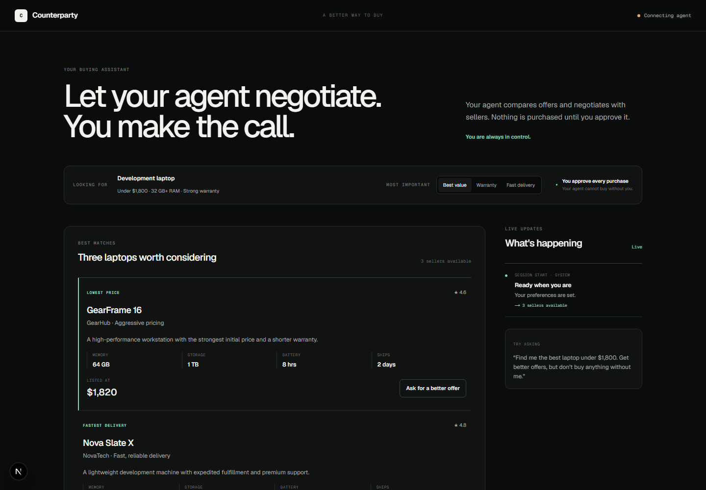
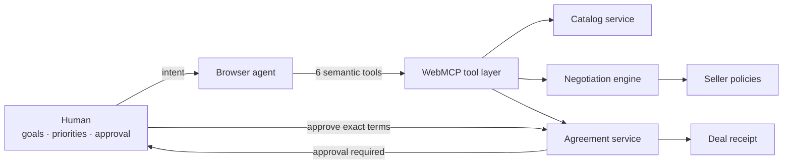

<div align="center">

# Counterparty

### Let agents negotiate. You make the call.

An agent-native marketplace where AI negotiates price, warranty, and delivery
with competing sellers—while the human keeps final authority.

[](https://counterparty-xi.vercel.app/)

[](https://webmachinelearning.github.io/webmcp/)
[](https://nextjs.org/)
[](https://www.typescriptlang.org/)
[](#quality)
[](LICENSE)

Built by [Deepanshu](https://github.com/deepanshu-iitm) for the
[WebMCP Challenge](https://webmcp.devpost.com/).

</div>



## The problem

Buying something expensive is rarely one simple search.

People open several tabs, compare sellers, weigh price against warranty and
delivery, negotiate where possible, and decide whether a better offer is worth
the tradeoff. An agent can help with the repetitive work—but it should not decide
what matters to the person or make a consequential purchase on its own.

## The solution

Counterparty divides the job deliberately:

**The agent handles**

- discovering suitable products;
- opening several seller negotiations;
- making structured counteroffers;
- comparing price, warranty, and delivery;
- preparing the strongest deal.

**The human controls**

- the budget and requirements;
- which tradeoff matters most;
- whether an agreement is acceptable;
- the final approval to commit.

The result is not an AI shopping chatbot. It is a shared negotiation workspace
where people and agents have different, visible responsibilities.

## The defining interaction

1. The agent negotiates with three sellers in parallel.
2. With **Best value** selected, the cheapest offer is recommended.
3. The human changes the priority to **Warranty**.
4. The agent reevaluates the same live offers and changes its recommendation.
5. The agent prepares an agreement and attempts to commit it.
6. Counterparty returns `HUMAN_APPROVAL_REQUIRED`.
7. The human approves the exact terms.
8. The same commit now succeeds and produces a receipt.

This interaction demonstrates the project’s central idea: the agent performs the
work, while the human supplies judgment and authority.

## Why WebMCP

Negotiation is stateful and semantic. A browser agent needs to understand offers,
rounds, counterparties, accepted terms, and approval—not infer intent from button
labels or page structure.

Counterparty registers six strict tools through
`document.modelContext.registerTool()`:

- **`search_products`** finds candidates using budget, memory, warranty, and
  ranking constraints.
- **`start_negotiation`** opens a stateful conversation with one seller.
- **`submit_counteroffer`** proposes price, warranty, and delivery terms.
- **`get_negotiations`** compares current offers using the human’s latest
  preference.
- **`prepare_agreement`** freezes accepted terms for review.
- **`commit_agreement`** finalizes only after explicit human approval.

Every tool has a strict JSON Schema with `additionalProperties: false`. Tool
calls update the same state shown in the human interface and activity trail.

## Architecture



The WebMCP surface and human interface call the same domain services. There is
no separate mock path for the agent.

## What makes the prototype reliable

### Stateful negotiation

Each negotiation tracks seller, product, current terms, history, status, and
remaining rounds. Sellers can accept, reject, or return a structured counter.

### Meaningful seller differences

Seller strategies produce genuine tradeoffs. One seller favors price, another
delivery, and another warranty and reputation. Private policy fields are never
returned through WebMCP tools.

### Human preference handoff

The current human preference is part of the shared state. Changing it affects
both the visible recommendation and the result returned to the agent.

### Approval integrity

Prepared terms receive a deterministic fingerprint. `commit_agreement` verifies
that the human approved the agreement and that its terms have not changed.
Modified terms invalidate the approval.

### Reproducible demonstration

The seller engine is deterministic, so judges can reliably reproduce the
complete flow without depending on external merchants or an LLM API.

## Try it

Open the [live application](https://counterparty-xi.vercel.app/) in ChatGPT’s
WebMCP-capable browser or Chrome with WebMCP testing enabled.

Suggested prompt:

> Find me a development laptop under $1,800 with at least 32 GB RAM. Negotiate
> with the strongest sellers, but do not buy anything without my approval.

During the run, change the visible priority from **Best value** to **Warranty**
and ask the agent to compare the offers again.

### Enable WebMCP in Chrome

Use Chrome 149 or newer and enable:

```text
chrome://flags/#enable-webmcp-testing
```

Then verify tool discovery:

```javascript
const tools = await document.modelContext.getTools();
tools.map((tool) => tool.name);
```

## Run locally

Requirements: Node.js 22+ and pnpm 11+.

```bash
git clone https://github.com/deepanshu-iitm/counterparty.git
cd counterparty
pnpm install
pnpm dev
```

Open [http://localhost:3000](http://localhost:3000).

## Quality

```bash
pnpm test
pnpm lint
pnpm build
```

The 18-test suite covers:

- catalog constraints and negotiable budget matching;
- seller-policy differences and negotiation transitions;
- all six strict WebMCP registrations;
- recommendation changes after human preference updates;
- premature commit rejection;
- approval and post-approval term integrity;
- the complete human-agent golden path.

## Built with

- Next.js 16 and React 19
- TypeScript
- WebMCP imperative API
- Tailwind CSS
- Vitest
- Vercel

## Prototype scope

Products, sellers, inventory, payments, and transaction receipts are simulated
for the hackathon. The WebMCP registrations, tool execution, negotiation state,
shared UI updates, recommendation changes, approval boundary, and integrity
checks are real.

## License

Released under the [MIT License](LICENSE).
